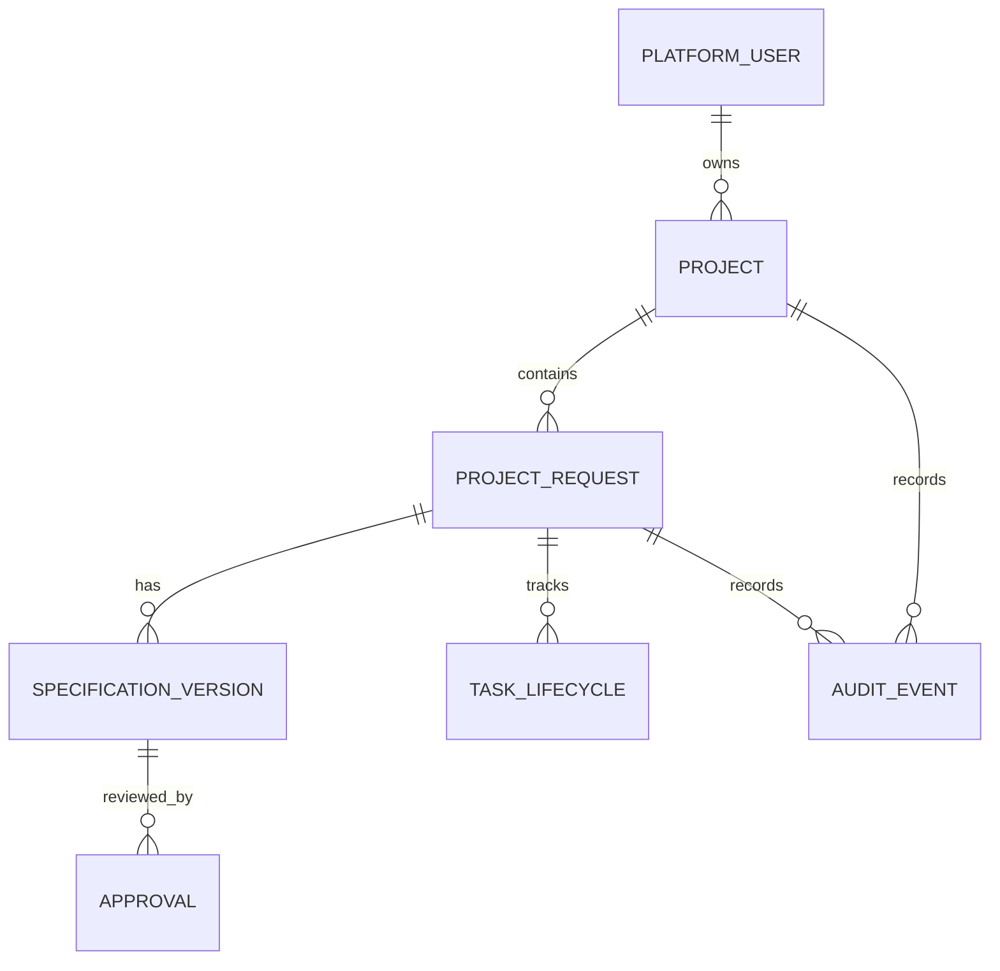

# Database schema

**Status:** In Design
**Schema state:** logical contract version 1 proposal only; no Catalyst project, tables, migrations, or persisted application records exist.

## Decision and evidence state

- **Founder Approved (2026-11-12):** real persistence for identity references, projects, project requests, task lifecycle, approvals, and audit events.
- **Proposed platform:** Catalyst Data Store after region, schema, query, indexing, permission, and billing checks.
- **Ownership:** individual account model; each project has one server-assigned owner. Workspaces/memberships are deferred.
- These approvals do not mean a schema is technically verified, implemented, or tested.
- The local M1 UI uses typed TypeScript fixtures in `apps/web/src/lib/demo-data.ts`; those objects are not database rows and are not persisted. No database, migration, or Catalyst Data Store connection exists.

## Data principles

- Every project-scoped record is owned by exactly one `owner_user_id` in M1. Child records may repeat that ID for efficient scoped queries; on every write, the service checks it matches the parent project owner.
- Set `owner_user_id` from the authenticated identity on the server. Never accept it as trusted client input.
- Require both record ID and verified owner predicate for every protected read/write. A unique Catalyst row ID is not an authorization check.
- Store only the identity provider and opaque provider subject needed to connect accounts. Avoid unnecessary profile and sensitive personal data.
- Persist timestamps, state, actor, and correlation identifiers. Do not persist credentials, provider secrets, raw authentication tokens, or unbounded prompts.
- Clearly mark demo fixtures and never return them through APIs that claim to read persisted records.
- Define retention, export, and deletion before release. Do not claim backup deletion behavior without a provider-confirmed statement.

## Entity relationship design

Each project and project-scoped child row stores `owner_user_id`, validated against `PROJECT.owner_user_id` by the server. `AUDIT_EVENT` may refer to an account-level target if no project applies; in that case its scope is explicit and access is restricted.

## Proposed logical entities

| Entity | Purpose | Candidate fields | Ownership and constraints |
|---|---|---|---|
| `PlatformUser` | Minimal internal identity mapping. | `id`, `auth_provider`, `provider_subject`, `created_at`, `status` | Unique `(auth_provider, provider_subject)`; no password/session secrets in this table. |
| `Project` | User's project container and current summary. | `schema_version`, `id`, `owner_user_id`, `name`, `category`, `status`, `created_at`, `updated_at`, `row_version` | Contract version 1; exactly one owner; server sets owner; allowed category/status values; owner index. |
| `ProjectRequest` | Structured request and current lifecycle. | `schema_version`, `id`, `project_id`, `owner_user_id`, `request_version`, `request_data`, `state`, `created_at`, `updated_at`, `submitted_at`, `cancelled_at`, `idempotency_key`, `row_version` | Owner must match project; bounded validated JSON; idempotency unique within owner scope. |
| `SpecificationVersion` | Immutable requirements/spec version reviewed by a user. | `schema_version`, `id`, `project_id`, `request_id`, `owner_user_id`, `version`, `content`, `content_sha256`, `created_at`, `created_by` | Unique `(request_id, version)`; content immutable after approval; canonical hash ties approval to exact bytes/representation. |
| `TaskLifecycle` | Persisted status shown in the activity UI. | `schema_version`, `id`, `request_id`, `project_id`, `owner_user_id`, `kind`, `state`, `created_at`, `updated_at`, `cancel_requested_at`, `finished_at`, `safe_error_code`, `row_version` | Contract version 1; M1 tracks request lifecycle only; no agent execution or generated output is implied. |
| `Approval` | Human decision on an exact spec version. | `schema_version`, `id`, `request_id`, `project_id`, `owner_user_id`, `specification_version_id`, `specification_hash`, `decision`, `actor_user_id`, `decided_at`, `comment` | Decision allowlist; actor authorized; spec version/hash required; append a new record for later decisions. |
| `AuditEvent` | Append-oriented security and lifecycle history. | `schema_version`, `id`, `owner_user_id`, `project_id`, `request_id`, `actor_type`, `actor_id`, `action`, `target_type`, `target_id`, `occurred_at`, `correlation_id`, `previous_event_hash`, `event_hash`, `safe_metadata` | No secrets/raw tokens; strict metadata allowlist; append-only through app APIs. Hash chaining can detect alteration but Data Store is not claimed to be immutable or tamper-proof against privileged admins. |

Workspace, Membership, Artifact, and AI/provider UsageLedger are out of M1 scope. Add them only through a separately reviewed schema change. Demo data is frontend-only or isolated fixture data and is never represented as a database row.

## Request lifecycle

The proposed states are `draft`, `submitted`, `needs_information`, `specification_ready`, `awaiting_approval`, `approved`, `rejected`, `cancelled`, and `failed`. The API document defines the transition graph. M1 may record approval but stops before implementation/agent dispatch. A state transition and matching audit event should be written atomically when the selected database allows; otherwise use idempotency and reconciliation.

## Indexes and integrity checks

- Index `Project(owner_user_id, updated_at)`.
- Index `ProjectRequest(owner_user_id, project_id, state, created_at)`.
- Index `TaskLifecycle(owner_user_id, request_id, updated_at)`.
- Enforce unique owner-scoped idempotency keys and unique specification versions.
- Resolve parent project and verify owner match on each child write; do not rely on the data store to enforce a foreign key unless confirmed.
- Check query filtering, indexes, atomicity/transactions, pagination, and isolation in a sandbox before adopting Catalyst Data Store.

## Input constraints (initial proposal)

- Validate every API field at runtime against explicit object schemas; reject unknown fields for mutation endpoints.
- Trim text and enforce documented character/byte limits; reject empty required values and malformed enumerations.
- Limit request body and nested-array lengths; store structured requirements in a versioned schema.
- Validate specification version and hash on approval; reject stale approval attempts.
- Use optimistic `row_version` or equivalent to reject concurrent stale state updates.
- Normalize timestamps to UTC; treat timestamps/owners/state as server-controlled fields.
- Establish exact numeric limits before implementation and enforce them server-side; don't invent unbounded content fields.
- Each external request/response and persisted contract carries `schemaVersion: 1`; future incompatible shapes require a new version and migration review. Candidate numeric caps and example contracts are recorded in [M1 Technical Preflight](M1_TECHNICAL_PREFLIGHT.md) and remain proposed until approved.

## Retention, export, and deletion proposal

No retention duration has been approved. Before production, set durations by data class, offer an export of a user's owned projects/requests/spec versions/approvals and user-visible audit history in a documented format, and provide a deletion workflow that removes or de-identifies data per policy. Decide whether minimal audit records must remain and for how long. Verify Catalyst's behavior for backups and subprocessors with the provider; make no claim that user deletion immediately deletes every backup copy.

## Open technical verification

Actual India account/DC and component availability; Catalyst table/column constraints and query/index capabilities; function-to-store access scopes; transaction/consistency behavior; export/deletion APIs; audit append strategy; retention and backup behavior; usage limits/billing. No database has been initialized.
